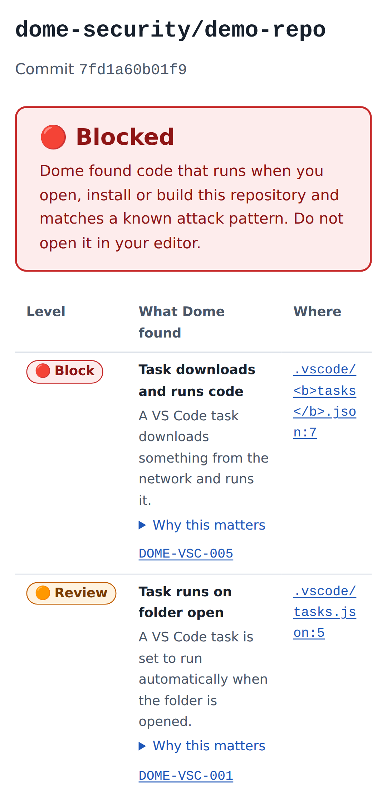
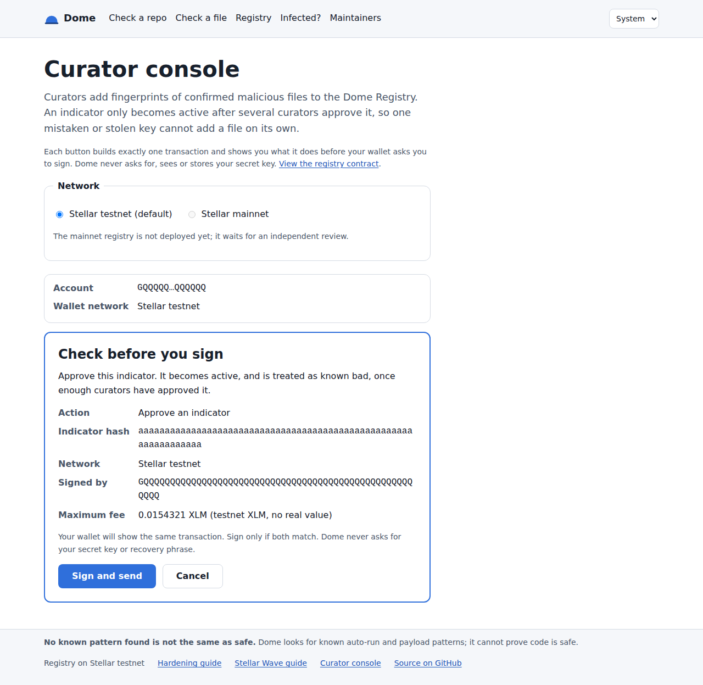

# dome-frontend

**The Dome web app: check a repo or file before you open it.**

Most developers hit by "open-the-folder" malware never had a chance to check first. dome-frontend is the place to check, with nothing to install and on a phone if that is all you have to hand: paste a GitHub link and see what the repository would run when you open, install or build it, or drop in a single file and find out whether it matches a known attack. Files are fingerprinted in the browser and never uploaded. Registry data is checked against the Stellar ledger, so you do not have to take Dome's word for it. Maintainers follow their repositories and set up scanning on every pull request, curators manage the Dome Registry with a Freighter wallet, and plain-language guides walk people through what to do if they think they were infected.

Part of the Dome Security org, alongside [dome-backend](https://github.com/DOME-security/Dome-backend) (scanner and API) and [dome-contracts](https://github.com/DOME-security/Dome-contracts) (the Dome Registry on Stellar). Dome protects open-source projects from auto-run malware and is built for the Stellar Wave Program on Drips.

---

## What it does

- **Check a repo** (`/check/repo`) — paste a public GitHub URL (optionally a branch or tag); the app queues a scan on dome-backend, follows its status with exponential backoff (1 s, 2 s, 4 s, 8 s, then every 15 s; it stops on a finished scan and offers a manual check after 10 minutes), and shows a report with 🔴 block / 🟠 review / ⚪ info findings, each linked to the exact file and line at the scanned commit. A failed scan is never shown as clean. The link is shareable (`?scan=<id>`).
- **Check a file** (`/check/file`) — drop a file (up to 25 MB, stated before you pick one) or paste a SHA-256; the fingerprint is computed **in the browser** with Web Crypto and only the hash is looked up. The file never leaves the device, and an end-to-end test proves it.
- **Registry explorer** (`/registry`, `/registry/indicator/:hash`) — active indicators by kind and campaign with paging. Every page is **spot-checked against the Stellar ledger** through the contract's own bindings: the list re-checks a sample with `is_known_bad`, and the indicator page shows the on-chain record (status, kind, every curator approval, retraction) and says plainly when the ledger and the Dome API disagree.
- **Repository page** (`/repos/:owner/:repo`) — the latest scan and on-chain attestation. The app recomputes the report hash in the browser and compares the indexed attestation with the contract's `latest()`.
- **Maintainer dashboard** (`/dashboard`) — follow your repositories and see each one's latest verdict and attestation, and copy the Dome GitHub Action workflow (`pull_request`, read-only token). GitHub sign-in is *planned*; until dome-backend offers it, the list is kept in your browser.
- **Curator console** (`/curate`) — connect Freighter (address and network always shown, with a warning if the wallet is on another network), then propose, approve or retract an indicator. Testnet is the default; mainnet needs an explicit switch and acknowledgement and stays off until a reviewed mainnet registry is configured. Each click builds and simulates **one** transaction and shows the action, indicator hash, network, signer and fee in plain language before the wallet is asked to sign. Dome never asks for or handles secret keys.
- **Guides** (`/guides/infected`, `/guides/hardening`, `/guides/wave`) — what to do if you think you were infected (disconnect, secure crypto first, rotate tokens, keys and sessions from a clean device, reset, report), editor and repository hardening (Workspace Trust, `task.allowAutomaticTasks` off in user settings, signed commits, rulesets, CODEOWNERS), and a safe review routine for a Stellar Wave, with tick-off checklists.
- **Fixed wording, no HTML** — the backend sends rule IDs and reason keys; every word of a finding comes from rule metadata vendored from dome-backend, and unknown rules get a safe generic label. Repository-supplied text (file paths, names) is only ever rendered as plain text. Every report ends with: *"No known pattern found is not the same as safe."*

| Report on a phone | Curator console: check before you sign |
|---|---|
|  |  |

More, at desktop and phone width, in [`docs/screenshots/`](docs/screenshots/) (regenerate with `pnpm screenshots`).

## Status

Pre-alpha, testnet only. Every page in the specification exists, with loading, empty and error states, and runs against dome-backend's API and the dome-contracts registry on testnet (the production build was checked reading the seeded demo indicator from the public testnet RPC). Coverage: 143 unit and component tests (Vitest, Testing Library, MSW) and 44 end-to-end tests run at desktop and phone size (Playwright), including axe on all 13 pages in light and dark themes with zero serious or critical violations, and a Lighthouse budget (mobile performance 95–98, accessibility 100 locally). The interfaces owned by the other two repositories are not published yet, so pinned placeholders live in [`src/vendor/`](src/vendor/README.md). There is no public deployment yet. See [Roadmap](#roadmap).

## Architecture

```
src/
├── main.tsx            Entry point: theme, TanStack Query, chain/wallet services, router
├── router.tsx          Route table; every page is a lazily loaded chunk
├── routes/             One folder per page
│   ├── home/               /
│   ├── check-repo/         /check/repo: submit, poll with backoff, report
│   ├── check-file/         /check/file: local hashing, size limit, known-bad lookup
│   ├── registry/           /registry and /registry/indicator/:hash, with ledger checks
│   ├── repo/               /repos/:owner/:repo: report-hash and attestation checks
│   ├── dashboard/          /dashboard: followed repositories, Action setup
│   ├── curate/             /curate: Freighter, network switch, one-transaction flow
│   ├── guides/             /guides/:slug, Markdown per locale
│   └── not-found/          404 and route error pages
├── components/         Report table, finding badge, verdict banner, ledger check, wallet button,
│                       hash field, file dropzone, scan progress, safe Markdown, layout
├── lib/
│   ├── api.ts              Typed dome-backend client: response checks, fixed error text
│   ├── api-schema.ts       Generated from src/vendor/openapi.json (pnpm generate:api)
│   ├── types.ts            API types, re-exported from the generated schema
│   ├── rules.ts            Rule ID and reason key → text, from src/vendor/rules.json
│   ├── polling.ts          Exponential backoff for scan status
│   ├── hash.ts             Web Crypto SHA-256, size limit, canonical report hash
│   ├── registry.ts         Explorer links, contract error messages, labels
│   ├── services.tsx        Lazy chain and wallet access, replaceable in tests
│   ├── stellar/            Registry client over the bindings, Freighter adapter,
│   │                       ledger spot-check comparisons, network passphrases
│   ├── config.ts           Build-time configuration (API, network, contract, RPC)
│   ├── github.ts           GitHub URL parsing and encoded file links
│   ├── markdown.ts         Markdown subset → data tree (no HTML path)
│   ├── watchlist.ts        Dashboard list, validated, in localStorage
│   └── theme.ts            Light / dark / system theme
├── i18n/               Every UI string (en.ts) and the Messages type a translation implements
├── content/guides/en/  Guide text in Markdown, rendered as React elements
├── vendor/             Pinned placeholders for files owned by other repos (see its README)
│   ├── openapi.json        dome-backend API
│   ├── rules.json          dome-backend rule metadata
│   └── registry-bindings/  dome-contracts generated TypeScript client, unmodified
├── styles/             Design tokens, light and dark themes, shared UI classes
└── test/               Test setup, MSW server, chain and wallet fakes, inert fixtures

config/                 CSP and security headers for builds, with tests for them and for the security lint rules
e2e/                    Playwright specs, mocked API, chain and wallet fakes, screenshot generator
scripts/                check-hygiene.sh (CI repo checks), sync-rules.mjs (refresh src/vendor/rules.json)
docs/                   Deployment guide, screenshots
.github/                CI, Dome scan, CodeQL, Scorecard workflows; Dependabot; CODEOWNERS
```

One package, one toolchain. The build is a static site, so the app has no server of its own and no secrets. The Stellar SDK and wallet code load only on pages that need them (main bundle about 105 KB gzipped):

| Layer | Tool | Members |
|---|---|---|
| App | [Vite](https://vite.dev) + React + TypeScript, [pnpm](https://pnpm.io) | `src/`, `public/`, `index.html` |
| Unit and component tests | [Vitest](https://vitest.dev) + Testing Library (jsdom) + [MSW](https://mswjs.io) | `src/**/*.test.ts(x)`, `config/*.test.ts` |
| End-to-end and accessibility | [Playwright](https://playwright.dev) (Chromium, desktop and phone) + axe-core | `e2e/` |
| Performance budget | [Lighthouse CI](https://github.com/GoogleChrome/lighthouse-ci) | `lighthouserc.json` |
| Lint and format | ESLint (security rules, no JSX literals) + Prettier | whole repo |
| Build hardening | Vite plugin in `vite.config.ts` using `config/security-headers.ts` | `dist/index.html` CSP meta tag, `dist/_headers` |

## Tech stack

- **Framework**: React 19 + TypeScript (strict), built with Vite 7 into a static site
- **Routing**: React Router 7, one lazy chunk per route
- **Data fetching**: TanStack Query 5 (scan polling with backoff, paged registry lists, cached ledger reads)
- **API types**: generated from an OpenAPI document with `openapi-typescript`
- **Stellar**: `@stellar/stellar-sdk` 17.2.1 with dome-contracts' generated registry bindings for ledger reads and curator transactions; `@stellar/freighter-api` for signing
- **Hashing**: Web Crypto `crypto.subtle.digest("SHA-256", …)`; canonical JSON hashing identical to dome-backend's `report-hash.ts`
- **Styling**: CSS modules on design tokens; light, dark and system themes; `prefers-reduced-motion` respected
- **Text**: one typed message catalogue per locale (`src/i18n/`); English today
- **Testing**: Vitest, Testing Library, MSW, Playwright, axe-core, Lighthouse CI
- **Supply chain**: exact dependency versions, `ignore-scripts=true`, pnpm build scripts blocked, 7-day minimum release age, Dependabot, SHA-pinned Actions, CodeQL, OpenSSF Scorecard

## Getting started

> This repo takes part in the **Stellar Wave Program on Drips**. Apply for an issue in the [Drips Wave app](https://www.drips.network/wave), **wait to be assigned**, and open a PR with `Closes #<issue>`. Points: **Trivial 100, Medium 150, High 200**. UI pull requests need screenshots at desktop and phone width. Rules for PRs are in [`CONTRIBUTING.md`](CONTRIBUTING.md).

Requirements: Node 22+ and pnpm 12. A local [dome-backend](https://github.com/DOME-security/Dome-backend) (`pnpm dev:server`, API on `:8080`) or a shared API URL. For the curator console, the Freighter extension in a browser profile that holds **only a testnet wallet**. Never connect a wallet holding real funds to a development build.

```bash
git clone https://github.com/DOME-security/Dome-frontend.git
cd Dome-frontend

# Dependencies never run install scripts
pnpm install --ignore-scripts

cp .env.example .env.local     # API URL, network (testnet), registry contract id, optional RPC URL
pnpm dev                       # http://localhost:5173, proxies /v1 to DOME_API_PROXY_TARGET
```

Run the full check suite, as CI does:

```bash
pnpm format:check
pnpm lint
pnpm typecheck
pnpm test                      # unit + component tests, API mocked with MSW
pnpm test:e2e                  # every flow, axe on every page, 320 px layout, mocked API and wallet
pnpm build && pnpm lighthouse  # performance and accessibility budget (set CHROME_PATH, see CONTRIBUTING.md)
./scripts/check-hygiene.sh
```

`pnpm test:e2e` needs Chromium once: `pnpm exec playwright install chromium`. `pnpm screenshots` regenerates `docs/screenshots/`. `pnpm generate:api` regenerates the API types after `src/vendor/openapi.json` changes. `pnpm build` writes the static site to `dist/`; see [`docs/deployment.md`](docs/deployment.md) for configuration, security headers and hosting.

## Design system

Tokens for colour, spacing, type and radius live in [`src/styles/tokens.css`](src/styles/tokens.css), with light and dark palettes; components use only the variables, and the dark palette passes the same axe contrast checks as the light one. The app is built phone-first for someone who has just seen a scary antivirus alert: large tap targets, nothing that scrolls sideways at 320 px, and words that explain rather than alarm. Severity is never shown by colour alone (🔴/🟠/⚪ always come with a text label), every control is keyboard reachable with a visible focus ring, there is a skip link, and animation stops under `prefers-reduced-motion`. No UI kit, no web fonts, no images beyond the logo.

## Related repositories

```
                 ┌──────────────────────────┐
  users ────────▶│  dome-frontend (this)    │
                 └───┬──────────────────┬───┘
     REST API (JSON) │                  │ Soroban RPC: read-only simulation,
                     │                  │ Freighter-signed curator transactions
                     ▼                  ▼
         ┌────────────────┐     ┌─────────────────────────────┐
         │ dome-backend   │────▶│ dome-contracts              │
         │ scans, API,    │◀────│ Dome Registry on Stellar    │
         │ indexer        │     └─────────────────────────────┘
         └────────────────┘
```

**[dome-backend](https://github.com/DOME-security/Dome-backend)**

- *What this app sends:* `POST /v1/scans` with `{ url, ref? }` for a public GitHub repository; `GET /v1/scans/:id`, polled with backoff until the scan is `done` or `failed`; `GET /v1/repos/:owner/:repo`; `GET /v1/indicators?limit=&cursor=`; and `GET /v1/indicators/:sha256` with a hash computed in the browser, never file contents. Requests carry no cookies. The app's origin must be listed in the backend's `CORS_ORIGINS`.
- *What it receives:* scan records (status, verdict, commit, the engine's JSON report with findings as rule ID, reason key, severity and locations, and `reportHash`), repository summaries with the indexed on-chain attestation, and pages of active indicators. The `reason` and `error` text in responses is never displayed.
- *What it never asks for:* any scanning. The frontend never clones, parses or runs repository code. Even its own CI scan uses the Dome Action from dome-backend.

**[dome-contracts](https://github.com/DOME-security/Dome-contracts)**

- *What this app reads:* `indicator`, `is_known_bad` and `latest` through Soroban RPC simulation (no fees, no account needed), to spot-check what the backend indexer serves, and `is_curator` before a curator acts.
- *What it sends:* `propose`, `approve` and `retract` transactions from the curator console, one per click, signed in the curator's Freighter wallet on testnet by default. Admin and attester actions are never signed through the frontend.

**Shared packages and interfaces**

| Interface | Owned by | Used here | Status |
|---|---|---|---|
| REST API (`docs/api.md`) | dome-backend | `src/vendor/openapi.json` → `src/lib/api-schema.ts` → `src/lib/api.ts` | No OpenAPI document upstream yet; written from the routes at a pinned commit |
| Rule metadata (IDs, titles, reasons, references) | dome-backend engine | `src/vendor/rules.json` → `src/lib/rules.ts` | No `rules.json` upstream yet; extracted by `scripts/sync-rules.mjs` |
| Canonical JSON report hash (`report-hash.ts`) | dome-backend | `src/lib/hash.ts` | Recomputed in the browser |
| `@dome-security/registry-bindings` | dome-contracts (`bindings/ts`) | `src/vendor/registry-bindings/` via `src/lib/stellar/registry-client.ts` | Not on npm yet; byte-identical copy at a pinned commit |
| Contract id per network | dome-contracts README | `VITE_REGISTRY_CONTRACT_ID` | Testnet only |
| Contract error codes (`errors.rs`, append-only) | dome-contracts | `src/i18n/en.ts` plain-language messages | In sync |
| Repo id: SHA-256 of `github.com/owner/repo`, lowercased | Convention between dome-contracts and dome-backend | `src/lib/stellar/registry-client.ts` | **Not yet agreed**: dome-backend's indexer does not use it, so repository spot-checks report a mismatch until it does |
| Indicator kinds | dome-contracts (`task`, `font`, `config`, `script`, `package`) vs dome-backend index (`hash`, `marker`, `package`, `domain`) | `src/i18n/en.ts` labels for both | **Differ**; the app labels both and the ledger check surfaces disagreements |

The exact shape assumed for each placeholder is in [`src/vendor/README.md`](src/vendor/README.md).

## Roadmap

Milestones from the original specification, compared with the code in this repo. Items marked *planned* do not exist yet.

- [x] **M1 Shell:** layout, routing with lazy routes, light/dark/system themes, home page, the three guides, 404 and error pages
- [x] **M2 Check:** `/check/repo` with backoff polling, shareable scan links and a "taking longer" state; `/check/file` with local hashing, a 25 MB limit and pasted-hash lookup; report components with rule reasons and "why this matters"
- [x] **M3 Registry**
  - [x] Explorer list with campaign filter and cursor paging, indicator page, `/repos/:owner/:repo`
  - [x] In-browser report-hash verification
  - [x] Spot-check of indexer data against the Stellar ledger through the contract bindings, with disagreements shown
  - [x] On-chain indicator record: status, kind, approvals, retraction
  - [ ] List proposed and retracted indicators, and per-indicator event history (*planned*; needs an indexer endpoint or event reads)
- [ ] **M4 Maintainers**
  - [x] `/dashboard` with followed repositories (stored in the browser) and Dome Action setup
  - [ ] GitHub sign-in and automatic repository list (*planned*; needs a GitHub OAuth app and an endpoint in dome-backend)
- [x] **M5 Curators:** `/curate` with Freighter, network display and mismatch warning, testnet default, mainnet switch with acknowledgement, one transaction per click with a plain-language summary and fee, contract errors in plain language
- [x] **M6 Polish**
  - [x] axe on every page in both themes, keyboard and 320 px checks in CI
  - [x] Lighthouse budget in CI (mobile performance ≥ 90, accessibility ≥ 95)
  - [x] All text in a typed message catalogue, enforced by lint
  - [ ] A second language (*planned*; rule text needs translations from dome-backend too)
- [ ] **Release readiness**
  - [x] CI: hygiene, format, lint, typecheck, unit tests on Node 22 and 24, stale-API-type check, build, Playwright, Lighthouse; CodeQL; OpenSSF Scorecard; Dome Action on every pull request; Dependabot
  - [x] `CODEOWNERS` for build config, `.github/`, manifests, lockfile and `src/vendor/`
  - [ ] Branch ruleset on `main` (signed commits, no force-push, code-owner review) (*planned*; a repository setting)
  - [ ] Replace `src/vendor/` placeholders with published `openapi.json`, `rules.json` and `@dome-security/registry-bindings` (*planned*; waits on the other repos)
  - [ ] Agree the repo id convention with dome-backend (*planned*)
  - [ ] Pin the Dome Action to its first release instead of building it from a commit (*planned*)
  - [ ] Public deployment with the headers from `dist/_headers` (*planned*)

## Security

The app shows verdicts about code that may be hostile and asks curators to sign transactions, so its rules are strict. Repository-supplied text is never rendered as HTML (`dangerouslySetInnerHTML`, `innerHTML`, `eval` and `javascript:` URLs are lint errors, proven by tests); verdict, reason and error wording come from the app, never from the API or the repo; files are hashed locally and only the hash is sent; registry data is verified against the ledger; production builds carry a strict Content Security Policy with no inline scripts, no third-party hosts or trackers, and connections only to the app, the Dome API and the configured Stellar RPC; curator actions are one transaction per click, summarised before signing, testnet by default, and never touch secret keys; build config stays small and code-owned, because in 2026 attackers hid payloads at the end of files like `postcss.config.mjs`; and nothing runs at install time. Found a vulnerability? Please don't open a public issue. Report it privately through **Report a vulnerability** on this repo, as described in [`SECURITY.md`](SECURITY.md).

## License

[Apache-2.0](LICENSE).

## Acknowledgments

Built for the Stellar Wave Program on Drips. Rule wording comes from dome-backend's rule metadata, and the registry client is generated by dome-contracts. References: [Freighter developer docs](https://docs.freighter.app), [Stellar JavaScript SDK](https://github.com/stellar/js-stellar-sdk), [MDN `SubtleCrypto.digest()`](https://developer.mozilla.org/en-US/docs/Web/API/SubtleCrypto/digest), [OWASP CSP Cheat Sheet](https://cheatsheetseries.owasp.org/cheatsheets/Content_Security_Policy_Cheat_Sheet.html), [WCAG 2.2](https://www.w3.org/TR/WCAG22/), Microsoft's [developer-targeting campaign using malicious Next.js repositories](https://www.microsoft.com/en-us/security/blog/2026/02/24/c2-developer-targeting-campaign/), and the [Drips Wave docs](https://docs.drips.network/wave).
